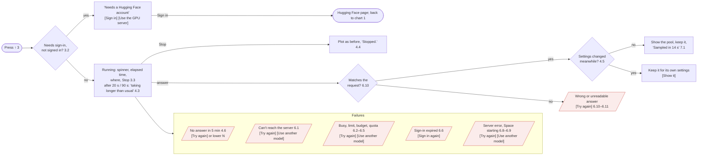

# What happens when you use the page: the full flow, and what can go wrong

Every path a visitor can take from opening the page to seeing a subset, including every failure we
know of. Each row says what the visitor sees; a row not yet right says what is missing. Ground rules:

- **Explicit.** Nothing changes the visitor's settings, switches where a run happens, or opens a
  sign-in page unless the visitor clicked something that says it will.
- **The plot matches the settings it says it does.** A pool is shown only for the configuration that
  made it (prompt, model weights, embedder, N, T′, max tokens).
- **Every failure says what happened, in plain words, and offers the next step that works** as a
  button.

Status column: ✅ works as intended · ⚠️ works but should improve · ❌ wrong or missing.

## Flowcharts

Two charts: opening the page, and pressing ↑. Every end (grey or red) leaves the visitor back at the
settings, with the plot showing a pool that matches what it says. Numbers refer to the tables below.
Red boxes are failures; each says what happened and offers a next step as a button.

**Opening the page and changing settings**

**Pressing ↑**

## 1. Opening the page

| Step | What happens | Status |
|---|---|---|
| 1.1 | Page, scripts and styles load (scripts live in a folder named after the commit, so a reload never mixes versions). | ✅ |
| 1.2 | The presets and the cache index load. At the same time the page asks the GPU server for `/status`. If that fails (down, or the server does not allow this site), the GPU server is listed as "— not available right now", its note says it can't be reached from this page, and Modal becomes the default for this visit. | ✅ |
| 1.2a | …the presets or the cache fail to load (offline, GitHub Pages hiccup). The plot-area panel says "The examples could not be loaded." with **Try again** (reloads the page); typing a prompt and ↑ still works. But the panel can be replaced by "Type a prompt, or pick one with +." when the GPU server check finishes after it (it redraws the empty panel). | ⚠️ |
| 1.3 | The first preset fills the prompt; the default settings (Qwen3-Embedding-0.6B, N 200, T′ 1.0, 128 tokens) match a precomputed pool, so it is shown at once with "Precomputed on the GPU server · draw 1 (completions 1–200)." This also happens when Modal is the default, since the weights are the same. | ✅ |
| 1.4 | Returning from a Hugging Face sign-in (`?code=…` in the address): the settings saved before leaving are restored and the run starts. See §5. | ✅ |
| 1.4a | …the visitor refused on Hugging Face's page (`?error=…`). The settings are restored and the panel says "Sign-in was cancelled." with **Sign in with Hugging Face** and **Use the GPU server**. But within a quarter second the restored settings trigger a settings check that replaces the panel (with the matching pool, or "No completions for these settings yet."), so the visitor barely sees it. **Use the GPU server** is offered even when the GPU server is marked not available. | ❌ |

## 2. Changing settings (no run yet)

| Event | What happens | Status |
|---|---|---|
| 2.1 | Pick a preset: only the prompt changes. | ✅ |
| 2.2 | Edit the prompt, N, T′, max tokens, model or embedder. If a precomputed pool or one of your runs from this visit matches exactly, it is shown. Otherwise the plot stays and the status says "The plot is from earlier settings. Press ↑." | ✅ |
| 2.3 | Change back to the shown pool's settings: the note returns to how that pool was made. | ✅ |
| 2.4 | Change only the embedder: the status says "Press ↑". On ↑, if the same backend already holds those completions, they are re-embedded without sampling ("Embedding the completions…"); otherwise they are sampled again. Not automatic, and the result still says "Sampled in …". | ⚠️ |
| 2.5 | Change the model to a backend that needs sign-in: the settings note says so. Nothing else happens until ↑. | ✅ |
| 2.6 | Every backend allows the same limits: N up to 200, max tokens up to 256. Typing more leaves the number in the field and the note under it says "The demo allows at most 200 samples and 256 tokens per completion; using 200 and 256." Values below the minimum (N < 2, max tokens < 8) and T′ outside 0.2–2 are changed without a note. | ✅ |

## 3. Pressing ↑

| Step | What happens | Status |
|---|---|---|
| 3.0 | Empty prompt: ↑ is disabled. | ✅ |
| 3.1 | A run is already going: ↑ is replaced by Stop; Enter does nothing. | ✅ |
| 3.2 | The backend needs sign-in and the visitor is not signed in: the plot-area panel says "Running on Modal needs a free Hugging Face account." with **Sign in with Hugging Face** and **Use the GPU server** (and **Cancel** when a plot is showing). The page leaves for Hugging Face only from the Sign in button. | ✅ |
| 3.3 | Otherwise the run starts: the panel over the plot shows a spinner, "Sampling 200 completions… 12 s", where it runs, and **Stop**. | ✅ |

## 4. While a run is in progress

| Event | What happens | Status |
|---|---|---|
| 4.1 | Normal. The servers report nothing until they finish, so we show elapsed time, not a percentage. | ✅ |
| 4.2 | Cold start (Modal, the Space): the panel says the first run starts a GPU, which can take a minute or two. | ✅ |
| 4.3 | Slower than usual (> 20 s on the GPU server, > 90 s elsewhere): the panel adds "This is taking longer than usual: the server may be busy with other requests, or a GPU is starting." | ✅ |
| 4.4 | Stop: the request is cancelled (the GPU server notices and stops generating); the plot returns to what it showed before; status "Stopped." | ✅ |
| 4.5 | The visitor changes settings during the run: the result is kept as one of "your runs" for the settings it was made with, and the status says "Done, but for earlier settings. Show it". **Show it** restores those settings and shows the pool. For a run started by "Draw new ones" (draw 2 or later), Show it shows draw 1 instead of the draw that just finished. | ⚠️ |
| 4.6 | No answer at all: after 5 minutes the page gives up: "No answer after 5 minutes. Try again, or lower N or max tokens." with **Try again**. | ✅ |
| 4.7 | The tab goes to the background (phones may suspend it). The request usually completes; if the connection is dropped it surfaces as 6.1. | ⚠️ untested |

## 5. Signing in with Hugging Face (Modal and the Space only)

| Step | What happens | Status |
|---|---|---|
| 5.1 | The visitor clicks Sign in (see 3.2): the settings are saved (session storage), the browser goes to Hugging Face. If the Hugging Face sign-in library cannot be loaded, the click does nothing and nothing is said. The settings saved are the ones from when the panel first appeared, even if the visitor changed them since. | ⚠️ |
| 5.2 | They approve: back on the page, the settings are restored and the run starts; the settings note says "Signed in as …". | ✅ |
| 5.3 | They refuse: see 1.4a. | ❌ |
| 5.4 | Session storage unavailable (some private modes): the saved settings are lost; the page opens on defaults and the status says "Signed in to Hugging Face as …", but it does not say "Press ↑ to run", and the status is cleared as soon as the examples load. | ⚠️ |
| 5.5 | The token expires (8 hours). Close to expiry the page treats the visitor as signed out, so ↑ shows the sign-in panel (3.2). If a run gets 401 anyway, we sign out and show 6.6 with **Sign in again**. The settings note keeps saying "Signed in as …" until the settings change. | ✅ |

## 6. Failures when the run returns

How each is recognised, what the panel says, and the next step offered. Every panel also has
**Dismiss** when a plot is showing. Codes are the ones in docs/BACKEND.md.

| # | Cause | How we know | Panel says | Next step | Status |
|---|---|---|---|---|---|
| 6.1 | Server unreachable: offline, down, DNS, **or the server does not allow this site (CORS)**. The browser reports all of these the same way. | `fetch` throws | "The GPU server isn't responding. It may be offline, or not yet open to this page." (for Modal: "The Modal isn't responding.") | [Try again] [Use another model] | ✅ wording for Modal is off ("The Modal"). Any other programming error of the same kind (a `TypeError`, e.g. from a broken answer) also lands here |
| 6.2 | Busy: the server is serving other requests | `busy`, or 429 with no code | "Many people are sampling right now." + the server's message | [Try again] [Use another model] | ✅ |
| 6.3 | Per-visitor limit (Modal: 20 runs a day) | `rate_limit` (429) | "You have reached this server's limit for now." + the server's message | [Use another model] | ✅ |
| 6.4 | Monthly budget used (Modal) | `budget` (429) | "This month's GPU budget for the demo is used up." | [Use another model] | ✅ |
| 6.5 | ZeroGPU daily quota used (Space) | error message containing "quota" | "Your daily Hugging Face GPU time is used up." + the quota message | [Use another model] | ✅ (Space untested end to end) |
| 6.6 | Not signed in / token expired | `auth` (401 or 403) | "Your Hugging Face sign-in has expired." | [Sign in again] [Use another model] | ✅ |
| 6.7 | Invalid settings (prompt too long, N out of range) | `bad_request` (400) | "The server did not accept these settings." + the server's message | — (should not happen: the fields are capped) | ✅ |
| 6.8 | Server error while sampling (out of memory, model crash, the Space's "No CUDA GPUs") | `server` (500), or the Space's `server: …` error | "The server hit an error while sampling." + its message | [Try again] [Use another model] | ✅ |
| 6.9 | The Space is asleep or rebuilding | 404/503 | "The Hugging Face Space is starting up." "Try again in a minute." | [Try again] | ✅ (untested on a real sleeping Space; if it answers without CORS it shows as 6.1). A 404 or 503 from the GPU server or Modal also says "starting up" |
| 6.10 | Answer arrives but does not match the request (fewer samples, other token limit) | compare N and max tokens | "The server did not run the requested settings." | [Try again] | ✅ never displayed as a pool. T′ is not compared, though docs/BACKEND.md says the page refuses any difference |
| 6.11 | Malformed answer (not JSON, missing fields) | parse error | "The server sent an answer the page could not read." | [Try again] | ⚠️ only for a non-JSON answer from the GPU server or Modal. Missing samples show as 6.10; a missing or broken G shows "Sampling failed."; a Space answer that is not JSON shows as 6.8; some broken answers show as 6.1 |

## 7. After a successful run

| Step | What happens | Status |
|---|---|---|
| 7.1 | The pool is shown; status "Sampled in 14 s (12 s generating, 2 s embedding). Draw 1 (completions 1–200)." The breakdown appears when the server reports one. When a run needed several requests, the breakdown is the last request's only. | ✅ |
| 7.2 | The run is kept for this visit: going back to its settings shows it again ("Sampled on Modal · draw 1 (completions 1–200)."). | ✅ |
| 7.3 | Most likely / Sample, T and K act on the pool without a new run. | ✅ |
| 7.4 | Numerical failures in the selection on pools whose log p spans hundreds of nats: the selection now runs in log space (`greedyMAPLog`, `kdpp` in js/dpp.js). When there is still no subset of size K (true duplicates), the note under the readout says so. | ✅ |
| 7.5 | "Draw new ones" (next to the status): shows the next N completions of the same settings, sampling only what is missing. Draws sampled live after a precomputed pool are labelled "Precomputed on the GPU server" when shown again. | ✅ |

## Findings to fix

Fixed: the 5-minute time limit (4.6); the sign-in panel instead of the redirect (3.2); failure panels
with next-step buttons and one message per cause (6.1–6.9); Modal's budget message (6.4); keeping a
run finished after a settings change (4.5); the note on the limits (2.6); the slow-run explanation
(4.3) and the timing breakdown (7.1); the GPU server marked "not available right now" at load (6.1).
The N × max tokens limit was dropped: 200 × 256 = 51,200, so it never applied.

Still open:

1. **The "Sign-in was cancelled" panel is replaced almost at once** (1.4a, 5.3). More generally, any
   settings check (including the GPU server check at load) replaces whatever panel is showing (1.2a).
2. **Show it after a "Draw new ones" run shows draw 1** (4.5).
3. **Malformed answers** get several different messages, and any `TypeError` reads as "isn't
   responding" (6.11, 6.1).
4. **Sign in does nothing if the Hugging Face library cannot load**, and it saves the settings from
   when the panel first appeared (5.1).
5. **No "Press ↑ to run" after a sign-in that lost its settings** (5.4).
6. **Small wording:** "The Modal isn't responding" (6.1); "starting up" for a 404 from the GPU server
   or Modal (6.9); **Use the GPU server** offered when it is marked not available (1.4a, 3.2).
7. **Re-embedding** for an embedder change happens only on ↑ (2.4).
8. **Untested paths:** a real run on the Space since the 4-bit switch, phones suspending background
   tabs (4.7).
