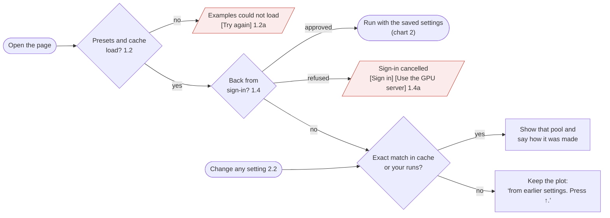

# What happens when you use the page: the full flow, and what can go wrong

Every path a visitor can take from opening the page to seeing a subset, including every failure we
know of. Each failure lists what the visitor sees today and what they should see. Ground rules:

- **Explicit.** Nothing changes the visitor's settings, switches where a run happens, or opens a
  sign-in page unless the visitor clicked something that says it will.
- **The plot matches the settings it says it does.** A pool is shown only for the configuration that
  made it (prompt, model weights, embedder, N, T′, max tokens).
- **Every failure says what happened, in plain words, and offers the next step that works** as a
  button.

Status column: ✅ works as intended today · ⚠️ works but should improve · ❌ wrong or missing.

## Flowcharts

Two charts: opening the page, and pressing ↑. Every end (grey or red) leaves the visitor back at the
settings, with the plot showing a pool that matches what it says. Numbers refer to the tables below.
Red boxes are failures; each says what happened and offers a next step as a button.

**Opening the page and changing settings**

**Pressing ↑**

## 1. Opening the page

| Step | What happens | Status |
|---|---|---|
| 1.1 | Page, scripts and styles load (scripts live in a folder named after the commit, so a reload never mixes versions). | ✅ |
| 1.2 | The presets and the cache index load. | ✅ |
| 1.2a | …they fail to load (offline, GitHub Pages hiccup). Today: small status text "Could not load the examples: …"; the plot area stays blank with no message. **Should:** the plot-area panel says the examples could not be loaded, with **Try again**; typing a prompt and ↑ still works. | ⚠️ |
| 1.3 | The first preset fills the prompt; the default settings (GPU server, Qwen3-Embedding-0.6B, N 200, T′ 1.0, 128 tokens) match a precomputed pool, so it is shown at once with "Precomputed with these settings." | ✅ |
| 1.4 | Returning from a Hugging Face sign-in (`?code=…` in the address): the settings saved before leaving are restored and the run starts. See §5. | ✅ |
| 1.4a | …the visitor refused on Hugging Face's page (`?error=access_denied`). Today: ignored; the saved prompt and settings are silently lost. **Should:** restore the settings and say "Sign-in was cancelled. [Sign in] or pick the GPU server." | ❌ |

## 2. Changing settings (no run yet)

| Event | What happens | Status |
|---|---|---|
| 2.1 | Pick a preset: only the prompt changes. | ✅ |
| 2.2 | Edit the prompt, N, T′, max tokens, model or embedder. If a precomputed pool or one of your runs from this visit matches exactly, it is shown. Otherwise the plot stays and the status says "The plot is from earlier settings. Press ↑." | ✅ |
| 2.3 | Change back to the shown pool's settings: the note returns to how that pool was made. | ✅ |
| 2.4 | Change only the embedder: today needs a new run. **Planned:** re-embed the same completions (`/embed`) with "Re-embedding 200 completions…", if the backend offers it; otherwise "Press ↑ to sample with this embedder." | ⚠️ planned |
| 2.5 | Change the model to a backend that needs sign-in: the settings note says so. Nothing else happens until ↑. | ✅ |
| 2.6 | Change N or max tokens beyond the backend's limit: the field is capped at the backend's maximum. | ⚠️ capped silently; **should** say "This backend allows at most 100 samples." next to the field |

## 3. Pressing ↑

| Step | What happens | Status |
|---|---|---|
| 3.0 | Empty prompt: ↑ is disabled. | ✅ |
| 3.1 | A run is already going: ↑ is replaced by Stop; Enter does nothing. | ✅ |
| 3.2 | The backend needs sign-in and the visitor is not signed in. Today: **the page redirects to Hugging Face at once.** **Should:** the plot-area panel says "Running on Modal needs a free Hugging Face account. [Sign in with Hugging Face] [Use the GPU server instead]". The redirect happens only from that button. | ❌ |
| 3.3 | Otherwise the run starts: the panel over the plot shows a spinner, "Sampling 200 completions… 12s", where it runs, and **Stop**. | ✅ |

## 4. While a run is in progress

| Event | What happens | Status |
|---|---|---|
| 4.1 | Normal. The servers report nothing until they finish, so we show elapsed time, not a percentage. | ✅ |
| 4.2 | Cold start (Modal, the Space): the panel says the first run starts a GPU. | ✅ |
| 4.3 | Slower than usual (> 20 s on the GPU server, > 90 s elsewhere). **Should** add: "This is taking longer than usual: the server may be busy with other requests, or a GPU is starting." | ❌ planned |
| 4.4 | Stop: the request is cancelled (the GPU server notices and stops generating); the plot returns to what it showed before; status "Stopped." | ✅ |
| 4.5 | The visitor changes settings during the run. Today: the result is discarded when it arrives. **Should:** keep it as one of "your runs" for the settings it was made with (it is a valid pool), show "Done; it is for the earlier settings. [Show it]". | ⚠️ |
| 4.6 | No answer at all. Today: **no time limit; the spinner can run forever.** **Should:** give up after 5 minutes: "No answer after 5 minutes. [Try again] or lower N or max tokens." | ❌ |
| 4.7 | The tab goes to the background (phones may suspend it). The request usually completes; if the connection is dropped it surfaces as 5.1. | ⚠️ untested |

## 5. Signing in with Hugging Face (Modal and the Space only)

| Step | What happens | Status |
|---|---|---|
| 5.1 | The visitor clicks Sign in: the settings are saved (session storage), the browser goes to Hugging Face. | ✅ (but see 3.2: today the trigger is ↑ itself) |
| 5.2 | They approve: back on the page, the settings are restored and the run starts, "Signed in as …". | ✅ |
| 5.3 | They refuse: see 1.4a. | ❌ |
| 5.4 | Session storage unavailable (some private modes): the saved settings are lost; the page opens on defaults. **Should** at least say "Signed in. Press ↑ to run." | ⚠️ |
| 5.5 | The token expires (8 hours): the next run gets 401; we sign out and say so. **Should** offer [Sign in again]. | ⚠️ |

## 6. Failures when the run returns

How each is recognised, what the panel should say, and the next step offered.

| # | Cause | How we know | Panel should say | Next step | Status |
|---|---|---|---|---|---|
| 6.1 | Server unreachable: offline, down, DNS, **or the server does not allow this site (CORS)**. The browser reports all of these the same way. | `fetch` throws | "The GPU server isn't responding. It may be offline." | [Try again] [Use Modal instead] | ⚠️ message exists, buttons missing. Note: today every GPU-server run lands here, because the server has no CORS rule for this site yet |
| 6.2 | Busy: the server's queue is full | 429 from the GPU server | "Many people are sampling right now." | [Try again] [Use Modal instead] | ⚠️ |
| 6.3 | Per-visitor limit (GPU server per hour; Modal 20 runs a day) | 429 with that message | the server's message | [Use another model] | ⚠️ |
| 6.4 | Monthly budget used (Modal) | 429 with that message | "This month's GPU budget for the demo is used up." | [Use the GPU server] | ❌ Modal's message still says "use an on-device model", which no longer exists |
| 6.5 | ZeroGPU daily quota used (Space) | error event naming the quota | "Your daily Hugging Face GPU time is used up (5 minutes a day for free accounts)." | [Use the GPU server] | ⚠️ |
| 6.6 | Not signed in / token expired | 401 | "Your Hugging Face sign-in expired." | [Sign in again] | ⚠️ |
| 6.7 | Invalid settings (prompt too long, N out of range) | 400 with a message | the server's message | — (should not happen: the fields are capped) | ✅ |
| 6.8 | Server error while sampling (out of memory, model crash, the Space's "No CUDA GPUs") | 5xx, or a Space error event | "The server hit an error while sampling." + its message | [Try again] [Use another model] | ⚠️ |
| 6.9 | The Space is asleep or rebuilding | 404/503 | "The Hugging Face Space is starting up; try again in a minute." | [Try again] | ⚠️ |
| 6.10 | Answer arrives but does not match the request (fewer samples, other token limit) | compare N and max tokens | "The server did not run the requested settings." | [Try again] | ✅ shown, never displayed as a pool |
| 6.11 | Malformed answer (not JSON, missing fields) | parse error | "The server sent an answer the page could not read." | [Try again] | ⚠️ falls into a generic error today |

## 7. After a successful run

| Step | What happens | Status |
|---|---|---|
| 7.1 | The pool is shown; status "Sampled in 14 s". **Should** add the server's breakdown when it reports one ("12 s generating, 2 s embedding"). | ⚠️ |
| 7.2 | The run is kept for this visit: going back to its settings shows it again ("Your earlier run with these settings."). | ✅ |
| 7.3 | Most likely / Sample, T and K act on the pool without a new run. | ✅ |
| 7.4 | Numerical failures in the selection (see the log-space work): Sample can fail and Most likely can return fewer than K on pools whose log p spans hundreds of nats. Today the cards simply show fewer items. **Should** not happen after the log-space routines; until then, say so. | ❌ being fixed |

## Findings to fix (from the ❌ and ⚠️ rows)

1. **No time limit on runs** (4.6). Add a 5-minute timeout with a clear message.
2. **↑ redirects to Hugging Face without asking** (3.2). Show a sign-in panel with an explicit button instead.
3. **A refused sign-in loses the visitor's settings silently** (1.4a, 5.3, 5.4).
4. **Failure messages lack next-step buttons** (6.1–6.9), and several causes share one generic message.
5. **Modal's budget message points to "on-device models"**, which were removed (6.4).
6. **A run finished after a settings change is thrown away** (4.5); keep it as a run for its own settings.
7. **Silent caps** on N and max tokens per backend (2.6).
8. **Slow-run explanation** (4.3) and the timing breakdown (7.1).
9. **Unreachable vs. not allowed (CORS)** cannot be told apart in the browser (6.1). Until the GPU server allows this site, every run on it fails; the panel should not suggest the server is broken when it is our configuration that is missing. Option: mark the GPU server "not available from this page yet" after a failed status check.
10. **Untested paths:** a real run on the Space since the 4-bit switch, phones suspending background tabs (4.7).
